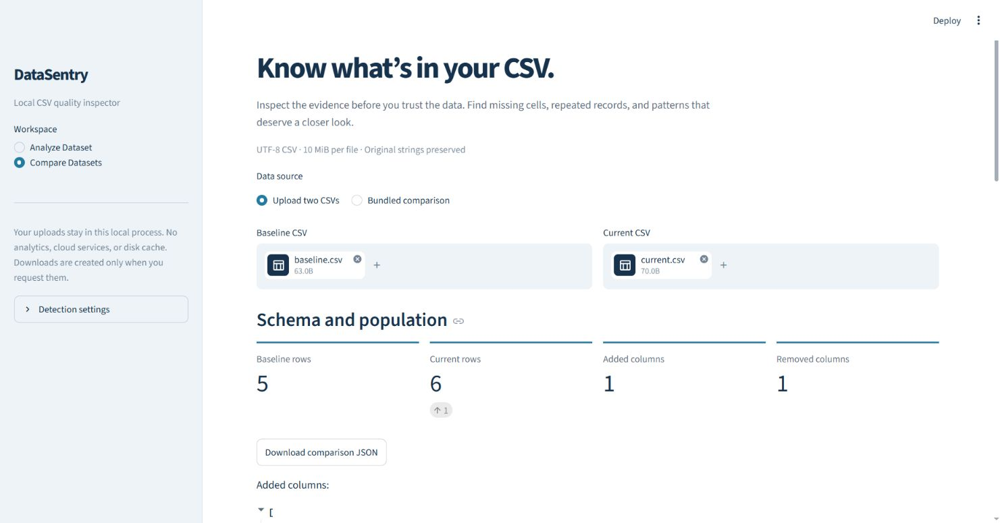
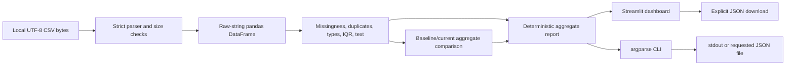

# DataSentry

**Local-first Python toolkit for CSV data profiling, quality checks, anomaly detection, and schema comparison.**

DataSentry helps developers inspect CSV files before trusting them. It shows what
was detected, where it occurred, and how the check works. Observed facts are
separated from heuristic concerns and uncertain inference. Nothing is repaired,
converted, or removed automatically.

## Run locally

Requires Python 3.11 or newer. Run these commands from the repository root:

```bash
python -m venv .venv
# Windows PowerShell:
.venv\Scripts\Activate.ps1
# macOS / Linux:
# source .venv/bin/activate
python -m pip install -e '.[dev]'
python -m streamlit run app.py
```

Open **http://127.0.0.1:8501**. The server binds to loopback by default. Choose
**Analyze Dataset** or **Compare Datasets** in the sidebar. Upload local files or
select the fictional bundled examples. Detection settings allow optional null
tokens, extra identifier columns, and per-column repeated-value checks.

The interface includes previews, summary metrics, missingness charts, category
and severity filters, column evidence, comparison directions, and JSON downloads.
Text variants can be revealed explicitly in the local column view. They are
excluded from report downloads.



Genuine local Chrome capture; no customer data is shown.

## Supported input

- Comma-separated CSV, UTF-8 with or without a UTF-8 BOM.
- Up to **10 MiB (10,485,760 bytes)** per file, inclusive.
- Header row required. Header-only files are valid zero-row datasets.
- Quoted fields, doubled quotes, commas and newlines inside quoted fields,
  empty cells, mixed content, CRLF/LF/CR record endings.
- Raw strings are preserved, including leading zeros and surrounding whitespace.
- Duplicate headers (also collisions after outer whitespace is stripped), blank
  headers, invalid quoting, null bytes, unsupported encodings, and ragged records
  fail with explicit errors before pandas can rename or coerce anything.

A row with fewer fields than its header is malformed and rejects the whole file.
Represent a missing value with an explicit empty field, such as `001,,Qatar`.
Blank physical records outside quoted fields also fail; they are never silently
skipped. A trailing record terminator is fine. Semicolon/tab-separated formats
are not auto-detected. A one-column CSV is valid.

## CLI

```bash
python -m datasentry analyze examples/golden.csv
python -m datasentry analyze examples/missing.csv -o analysis.json
python -m datasentry analyze examples/clean.csv --duplicate-column country
python -m datasentry analyze input.csv --null-token NULL --identifier customer_number
python -m datasentry compare examples/baseline.csv examples/current.csv -o comparison.json
```

The installed `datasentry` command accepts the same arguments. `--null-token`,
`--identifier`, and `--duplicate-column` are repeatable. Selected duplicate
columns are checked independently, not as a composite key. Identifier overrides
in comparisons can refer to a column present on either side.

JSON goes to stdout unless `-o` is supplied. Exit codes: **0** completed analysis
(including findings), **2** invalid arguments/input/configuration, **1** unexpected
execution or report-output failure. Output cannot overwrite an input CSV,
including through a symlink or hard link. An explicit output path may overwrite
an existing report. Parent output directories must already exist.

## How the checks work

| Check | Rule | Interpretation |
| --- | --- | --- |
| Missing cells | Empty or Unicode-whitespace-only strings; optionally exact case-sensitive null tokens after outer whitespace stripping | Confirmed missingness under the selected policy. `NA`, `null`, and `NaN` remain legitimate text by default. |
| Exact duplicate rows | Raw string equality across every column; excess records after the first occurrence are counted | Confirmed repetition, not proof of invalidity. The report separately counts all participating group members. No normalization, token substitution, or deletion. |
| Selected column repeats | Non-missing raw values repeated after the first, per selected column | Informational; only an error when the domain requires uniqueness. |
| Type inference | At least 5 non-missing values, at least 5 supporting examples, and at least 90% agreement | Heuristic. Numeric or date minorities are suspected mismatches only when a numeric/date dominant type is inferred. Otherwise mixed syntax is uncertain, with class counts. |
| Dates | Exactly `YYYY-MM-DD`, validated against the calendar | Syntax only; ambiguous dates and timestamps are not interpreted as verified dates. |
| Identifier protection | Name tokens such as ID, SKU, phone, postal/code, or account; camelCase names; leading-zero integers; mostly long digit sequences; explicit overrides | Heuristic identifier labels skip type-mismatch, IQR, and text-variant warnings. Raw data never changes. |
| Statistical anomalies | At least 8 finite numeric observations in a reliably numeric column; inclusive linearly interpolated quartiles; outside Q1−1.5×IQR or Q3+1.5×IQR | Suspected anomalies, not confirmed mistakes. Missing and nonnumeric cells are excluded. Bounds and numeric sample size are reported. |
| Text variants | Collapse Unicode whitespace and casefold, group distinct raw strings with the same normalized form | Heuristic concern. Counts include all rows in each variant group. Identifier-like columns are skipped; variants are never merged. |

Missing percentages use all rows in the column, or all cells for the dataset
total. Duplicate-row rate uses excess rows divided by dataset rows. Selected
column repetition rates use non-missing rows as their denominator. Empty
denominators produce 0%, alongside a row/sample count of zero. Percentages and
percentage-point changes are rounded to six decimal places.

**Row positions are one-based data-row positions, excluding the header.** They
are not physical CSV line numbers, because quoted fields can contain newlines.
Example lists are capped at 20; full counts remain accurate. Text details cap
both example groups and variants per group at 20. Findings can overlap across
checks; do not sum their affected-row counts into a supposed unique error count.
`issue_count` counts finding objects, not bad cells or bad rows.

Each finding includes a stable issue code, category, severity, confidence,
dataset/column scope, affected count, example row positions, explanation,
detection method, and suggested action. `warning` means review is warranted;
`info` supplies context. `confirmed` describes an observed pattern under the
documented rule, `heuristic` a possible concern, and `uncertain` insufficient
evidence. None establishes that a customer record is wrong.

## Comparison semantics

Comparison reports contain confirmed added/removed columns, the full column
sequences, shared-column relative-order changes, and row-count changes. Adding
a column changes the sequence without necessarily reordering shared columns.
Shared columns also receive inferred type differences and missing-rate changes;
dataset duplicate rates are compared separately. Both full aggregate profiles
are included for context.

Rate changes are **percentage points**, not relative percentage growth. An
increase is labeled a regression and a decrease an improvement, conditional on
less missingness/repetition being desirable. These labels do not establish
business correctness. Different row populations, null policies, or full schemas
can change rates. No record-level additions or deletions are inferred; the MVP
does not perform unique-key matching.

## Privacy and limitations

- Uploads stay in process memory. There is no upload persistence, disk cache,
  external analytics, cloud service, API key, or content execution. Streamlit
  usage telemetry is disabled in the project configuration. CLI reports are
  written only to explicitly requested destinations. Close the local server to
  release its process; memory lifetime follows Streamlit sessions and cleanup.
- Reports contain schema names, aggregate metrics, limited row positions, and
  statistical bounds, not raw field values, previews, source filenames, or
  null-token strings. Schema names and aggregates can still be sensitive;
  inspect reports before sharing them. The local dashboard intentionally shows
  a preview, with raw text variants behind an explicit checkbox.
- Inference is syntax-based. There are no domain rules, required-field schemas,
  uniqueness contracts, locale-aware numbers, currency parsing, or semantic
  date checks. Text means unrecognized numeric/date syntax, not verified text
  validity. Uniform invalid date strings can therefore be inferred as text.
- Identifier protection favors fewer misleading warnings. It can suppress
  legitimate numeric checks (for example, a measurement containing `01`), and
  unfamiliar identifier names can escape protection. Use explicit overrides.
- Numeric statistics use finite binary floats, with their normal precision
  limits; high-precision decimals may collapse. Overflow/underflow literals are
  surfaced as uncertain numeric-range findings. IQR checks skip and explain
  insufficient samples, zero IQR, unreliable numeric inference, identifiers,
  and unsafe arithmetic. Zero-IQR populations can hide isolated anomalies.
- Text grouping is linguistic normalization, not semantic equivalence. Case and
  spacing may be meaningful; Unicode casefold can group distinct spellings.
- A file-size limit does not guarantee fixed memory or run time: pandas and
  grouping structures expand CSV data in memory. This is an interactive local
  inspector, not a streaming big-data processor.
- Reports are deterministic for the same data/configuration and dependency
  versions, without timestamps. Dependency ranges permit updates; downstream
  reproducibility should record installed versions.

## Tests and verification

```bash
python -m pytest
ruff check .
ruff format --check .
python -c "import datasentry; import datasentry.cli; import app"
python -m datasentry analyze examples/golden.csv -o analysis.json
python -m datasentry compare examples/baseline.csv examples/current.csv -o comparison.json
```

The independent [fixture ledger](examples/EXPECTED.md) enumerates planted
defects, exact counts, rates, row positions, and hand-calculated quartiles.
Tests cover every detector, parser boundaries, immutability, deterministic and
private reports, CLI failures, dashboard uploads, filters, and comparisons.
Streamlit's [AppTest](https://docs.streamlit.io/develop/api-reference/app-testing/st.testing.v1.apptest)
simulates widget interactions; it is distinct from browser-based verification.
Exact-row duplicate semantics follow pandas' documented
[`duplicated`](https://pandas.pydata.org/docs/reference/api/pandas.DataFrame.duplicated.html)
behavior with `keep="first"` and `keep=False`.
GitHub Actions runs tests, Ruff, imports, and CLI report smoke checks on Python
3.11 and 3.14. See [verification evidence](docs/VERIFICATION.md) for the checks
actually executed on the delivered revision.

## Architecture



`src/datasentry/ingestion.py` owns input safety. `profiling.py` owns pure analysis
and detector functions; `compare.py` compares reports and schema facts.
`reports.py` serializes JSON; `cli.py` provides the command entry point.
`app.py` handles local display and user controls. The engine imports no Streamlit
code and is reusable directly from Python:

```python
from datasentry import analyze_dataset, load_csv, report_json

frame = load_csv(b"id,value\n001,\n002,42\n")
report = analyze_dataset(frame)
print(report_json(report))
```

MIT licensed. No release tag is created by the initial MVP delivery.
